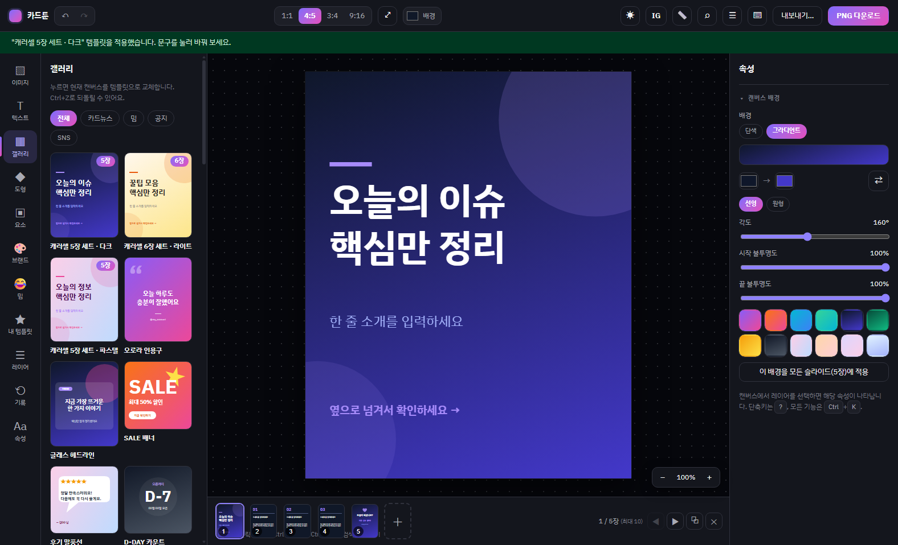
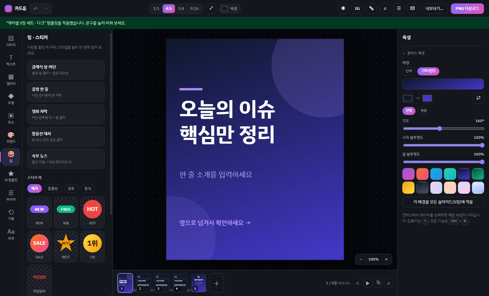
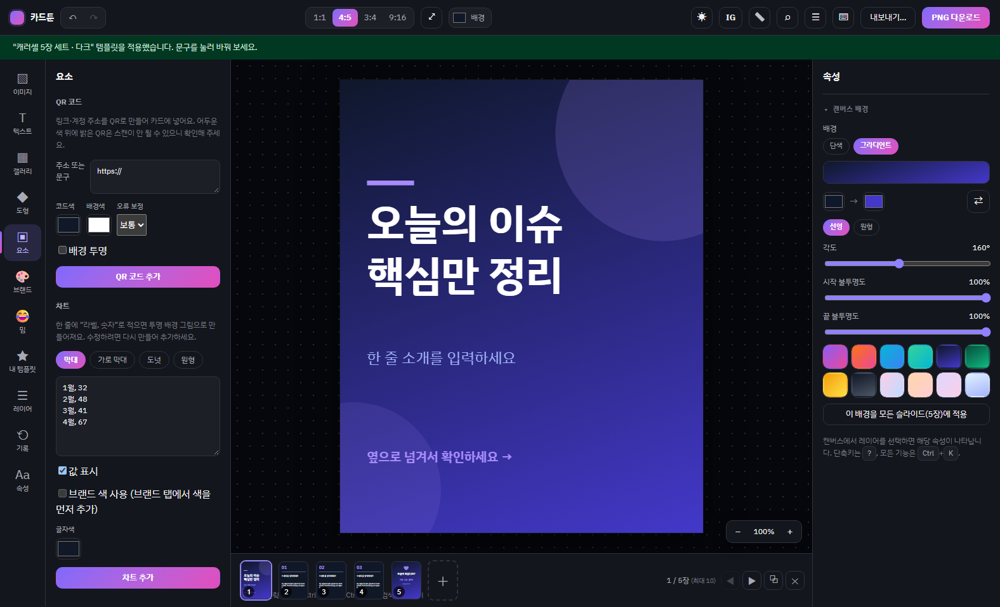
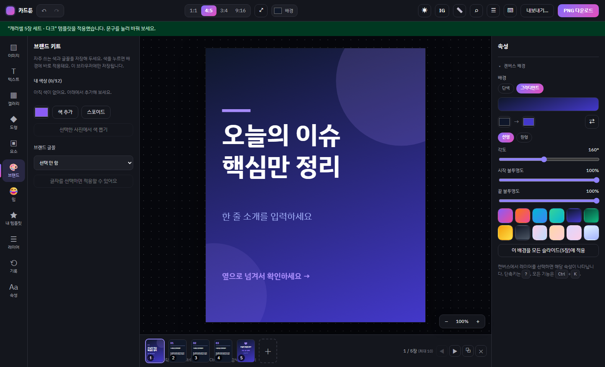
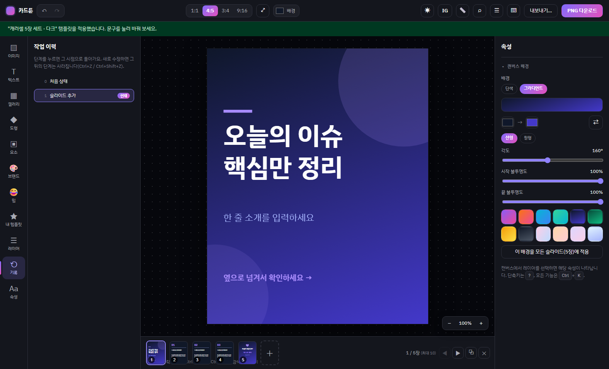
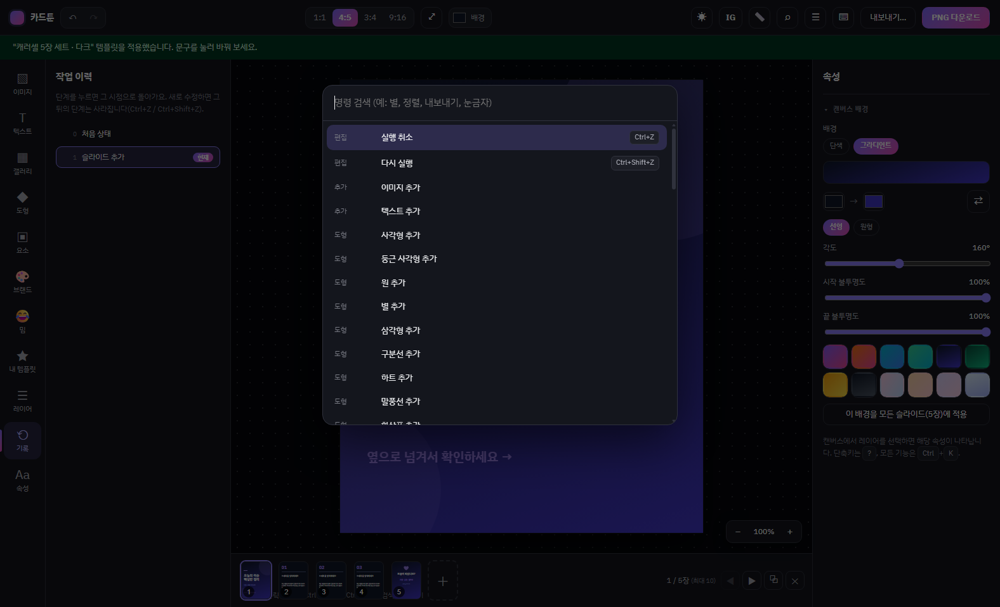
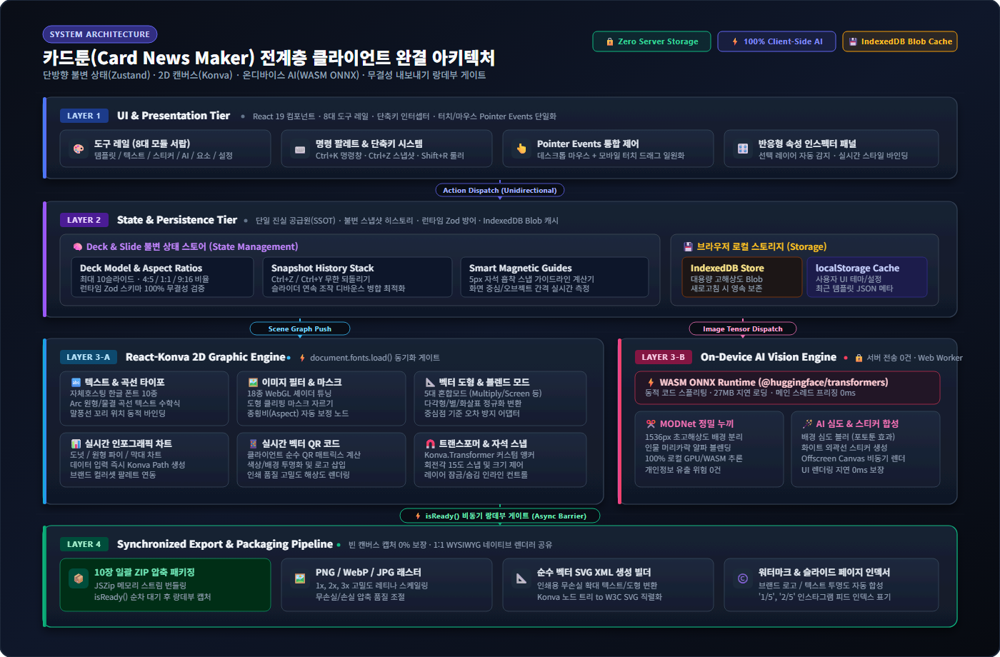

# 🎨 카드툰 (Card News Maker) - 프로젝트 포트폴리오

> **"서버 통신 0건, 개인정보 침해 없는 고성능 브라우저 온디바이스 카드뉴스 & 밈 편집기"**

- **배포 URL**: [https://card-news-maker-beige.vercel.app/](https://card-news-maker-beige.vercel.app/)
- **개발 환경 / 언어**: React 19, TypeScript, Konva.js, Vite, WebAssembly (ONNX Runtime)
- **주요 역할**: 프론트엔드 아키텍처 설계, 2D 캔버스 엔진 구현, 온디바이스 AI 통합, 불변 상태 관리 및 테스트/배포 자동화 파이프라인 구축 (100% 기여)

---

## 1. 프로젝트 개요 & 핵심 가치

| 항목 | 내용 |
|---|---|
| **프로젝트명** | 카드툰 (Card News Maker) |
| **형태** | 단일 페이지 웹 애플리케이션 (SPA) / PWA 지원 |
| **핵심 목표** | 별도의 회원가입이나 백엔드 서버 없이, 브라우저 단에서 고해상도 카드뉴스와 밈을 전문 그래픽 소프트웨어처럼 빠르고 안전하게 제작·내보내기 |
| **핵심 지표** | • **서버 전송 0건**: 업로드 이미지 및 AI 연산 100% 클라이언트 로컬 처리<br>• **검증 템플릿 42종**: 인스타그램 캐러셀, 공지, 밈 등 원클릭 프리셋<br>• **캐러셀 10장 덱 지원**: 다중 슬라이드 편집 및 일괄 ZIP 다운로드<br>• **자체 호스팅 폰트 10종**: Google Fonts 외부 호출을 제거하여 엄격한 CSP 및 제3자 트래킹 차단 |

---

## 2. 최신 실제 운영 화면 (2026 운영 버전)

| 화면 구분 | 실제 스크린샷 | 주요 설명 |
|---|---|---|
| **캐러셀 덱 편집기** |  | 4:5 인스타 피드 규격 및 하단 슬라이드 덱(스트립) 스트럭처 |
| **텍스트 정밀 속성** |  | 곡선 텍스트, 외곽선, 그라디언트, 그림자, 자간/행간 정밀 패널 |
| **밈 & 스티커 팩** |  | 상하단 클래식 자막, 영화 자막 및 24종 배지/말풍선 스티커 |
| **동적 요소 (QR/차트)** |  | 클라이언트 사이드 실시간 QR 코드 생성 및 데이터 차트 렌더러 |
| **브랜드 키트** |  | 업로드 사진 대표 색상 5종 자동 추출 및 브랜드 컬러/글꼴 보관함 |
| **타임라인 작업 이력** |  | 단계별 작업 라벨링 자동 분석 및 타임슬립 복원 타임라인 |
| **고해상도 일괄 내보내기** |  | PNG/JPG/WebP/SVG, 페이지 번호, 워터마크 및 ZIP 압축 내보내기 |
| **단축키 & 명령 팔레트** |  | `Ctrl + K` 빠른 도구 실행 및 파워 유저 키보드 인터랙션 |

---

## 3. 기술 스택 & 선정 이유

```text
Frontend Framework  │ React 19 (선언적 UI 컴포넌트 모델 및 최신 렌더링 최적화)
Canvas Engine       │ Konva.js 10.3 & react-konva 19 (복잡한 2D 씬 그래프 관리 및 고성능 렌더링)
Language & Tooling  │ TypeScript 6.0 (Strict Mode), Vite 8.2 (초고속 빌드/HMR), Oxlint
On-Device AI (WASM) │ @huggingface/transformers 4.3 + MODNet (WebAssembly 기반 브라우저 내 배경 제거)
Storage Strategy    │ IndexedDB (대용량 이미지/슬라이드 덱 자동저장) + localStorage (설정/템플릿)
Testing & CI        │ Vitest 3.2 (단위 테스트), Playwright 1.55 (E2E 스모크 테스트), GitHub Actions CI
Deployment          │ Vercel (정적 호스팅 및 엄격한 보안 헤더 CSP 적용)
```

### 왜 Konva.js인가?
- **DOM vs Canvas**: 복잡한 필터, 그림자, 회전, 수십 개의 레이어를 DOM으로 다루면 리플로우(Reflow) 병목이 발생합니다.
- **Fabric.js vs Konva.js**: React 생태계와의 궁합(선언형 컴포넌트 바인딩)에서 `react-konva`가 압도적인 가독성과 상태 일관성을 제공하며, 계층형 노드 그룹핑(Group/Layer) 제어가 직관적입니다.
- **WYSIWYG 보장**: 편집 화면과 내보내기 결과물이 동일한 Stage 엔진을 공유하므로 왜곡 없는 결과물을 보장합니다.

---

## 4. 핵심 아키텍처 및 시스템 흐름



> 💡 **[고해상도 원본 벡터 다이어그램 열기 (SVG)](images/architecture.svg)** | **[PNG 다운로드](images/architecture.png)**

| 계층 (Layer) | 주요 기술 & 모듈 | 아키텍처 설계 의도 및 엔지니어링 성과 |
|---|---|---|
| **Layer 1: UI & Dispatch** | `React 19`, 8대 도구 레일, Pointer Events 통합 제어, 단축키(Ctrl+K/Z) | 모바일 터치와 데스크톱 마우스 입력을 Pointer Events로 단일화. 모든 상호작용을 단방향 불변 액션으로 디스패치. |
| **Layer 2: State & Storage** | `Zustand` SSOT, 순수 리듀서 스냅샷 스택, `Zod` 방어, `IndexedDB` Blob 캐시 | 불변 업데이트로 Undo/Redo 무결성 100% 보장. 5MB 용량 한계의 localStorage를 탈피하여 대용량 고해상도 이미지 영속화. |
| **Layer 3-A: Canvas 2D Engine** | `React-Konva 10.3`, `document.fonts.load()` 동기화, 18종 WebGL 필터, 5px 자석 스냅 | 60FPS 하드웨어 가속 가상 씬 그래프. 캔버스 웹폰트 렌더링 누락 결함을 비동기 폰트 준비 신호로 완벽 해결. |
| **Layer 3-B: On-Device AI** | `@huggingface/transformers`, `MODNet WASM ONNX`, Web Worker 격리 | 서버 비용 0원, 개인정보 유출 0건의 100% 로컬 AI 누끼. 27MB WASM 번들 동적 분할로 초기 로딩 0초 유지. |
| **Layer 4: Synchronized Export** | `isReady()` 랑데부 게이트, `stage.toDataURL()`, `JSZip` 스트림 패키징 | 다중 슬라이드 일괄 캡처 시 비동기 로딩 레이스 컨디션을 방지하는 랑데부 배리어로 빈 화면 결함 0% 보증. |

---

## 5. 주요 기능 상세

### 1) 전문 그래픽 편집 & 타이포그래피
- **한글 타이포그래피 정밀 제어**: 자간, 행간, 텍스트 외곽선(Stroke), 드롭 섀도우(색상/블러/오프셋).
- **곡선 텍스트 (Curved Text)**: 원호 중심 각도 및 접선 회전 수학 공식을 적용하여 아치형(∩) 및 스마일형(∪) 텍스트를 비트맵 노드로 실시간 합성.
- **도형 & 5대 혼합 모드 (Blend Mode)**: 사각형, 원(타원), 별, 삼각형, 구분선 및 Multiply, Screen, Overlay 등 지원.
- **이미지 직접 자르기 & 모양 오리기**: 마우스 드래그 및 휠 줌을 통한 직관적 크롭, 원형/별/하트 모양 클리핑 마스크.

### 2) 브라우저 온디바이스 AI
- **WebAssembly 기반 AI 배경 제거 (누끼 따기)**:
  - 서버로 사진을 보내지 않고, 브라우저 로컬에서 `Xenova/modnet` 신경망을 구동하여 1536px 해상도의 인물 누끼 정밀 추출.
  - 최초 1회 모델 가중치(약 25MB) 다운로드 후 브라우저 캐시 활용, 이후 완전 오프라인 동작 가능.
- **스마트 인물 모드 (배경 블러)**: 피사체 알파 매팅 레이어와 원본 블러 배경을 합성하여 DSLR 심도 효과 재현.
- **스티커 외곽선 (Sticker Stroke)**: 투명 알파 채널 경계를 팽창(Dilation)시켜 굿즈 스티커와 같은 화이트 아웃라인 생성.

### 3) 직관적인 사용자 경험 (UX)
- **마그네틱 스냅 가이드**: 레이어 드래그 시 캔버스 중심/가장자리 및 주변 레이어 경계에 자석처럼 흡착(5px 임계값)되며 분홍 가이드라인 표시.
- **무제한 실행 취소/다시 실행 (Undo/Redo)**:
  - 불변 객체 스냅샷 타임라인 구축.
  - 슬라이더 조작과 같은 연속된 미세 입력은 1단계로 자동 병합(Debounce/Merge)하여 히스토리 낭비 방지.
- **눈금자(Ruler) 및 드래그 가이드선**: `Shift+R` 단축키로 토글, 눈금자에서 드래그하여 임의의 수평/수직 가이드 배치.
- **명령 팔레트 (Command Palette)**: `Ctrl+K` 단축키로 모든 도구 및 액션 빠른 검색 실행.

### 4) 인스타그램 캐러셀 덱 & 일괄 내보내기
- **슬라이드 덱(Deck) 아키텍처**: 최대 10장의 슬라이드를 순서 변경, 복제, 추가할 수 있는 캐러셀 스트립.
- **isReady 비동기 동기화 게이트**: 슬라이드 전환 직후 이미지 로딩 지연으로 인한 빈 화면 캡처 결함을 방지하기 위해, 모든 이미지 노드와 폰트 로드가 완료될 때까지 대기 후 캡처.
- **ZIP 일괄 다운로드 & 순수 SVG 벡터 빌더**: `01.jpg`, `02.jpg` 순서로 일괄 압축 패키징 및 벡터 SVG XML 생성 지원.

---

## 6. 핵심 엔지니어링 문제 해결 (Troubleshooting)

### 📌 Case 1. Konva 캔버스에서 한글 웹폰트가 누락되고 기본 폰트로 폴백되는 현상
- **문제**: UI에서 '주아', '도현' 체를 선택했으나 캔버스 렌더링 시 Malgun Gothic으로 폴백됨.
- **원인**: 브라우저의 Canvas API는 일반 HTML DOM과 달리 아직 화면에 그려지지 않은 웹폰트를 능동적으로 네트워크에서 가져오지 않음.
- **해결책**: 텍스트 레이어가 참조하는 폰트를 `document.fonts.load()`로 명시적 프리로드하고, 준비 완료 시점에 캔버스 Stage의 `fontKey` 상태를 변경하여 강제 리렌더링 트리거.
- **인사이트**: 캔버스 그래픽스에서 폰트는 'CSS 선언'이 아니라 '네트워크 로드 완료 상태'를 프로그래밍적으로 감지해야 함.

### 📌 Case 2. 스냅샷 기반 Undo/Redo에서 이전 상태가 오염되는 현상
- **문제**: 레이어 순서를 바꾼 뒤 Ctrl+Z를 누르면 이전 상태가 복원되지 않고 현재 상태와 섞여버림.
- **원인**: 기존 `handleMoveLayer` 함수가 레이어 객체의 `zIndex` 속성을 인플레이스(In-place mutation)로 수정하여, 히스토리 스택에 저장된 과거 스냅샷이 동일한 메모리 참조를 공유함.
- **해결책**: `reorderLayers`를 비롯하여 모든 레이어 조작 로직을 스프레드 연산자 및 순수 함수 기반의 불변 업데이트(Immutable Update)로 전면 리팩토링.
- **인사이트**: 타임라인 기반 이력 아키텍처에서는 단 하나의 가변(Mutable) 코드가 전체 상태 무결성을 붕괴시킬 수 있음.

### 📌 Case 3. 다중 슬라이드 일괄 내보내기 시 빈 이미지 저장 현상
- **문제**: 5장 세트 템플릿을 ZIP으로 일괄 내보낼 때 2~4번 슬라이드의 이미지가 누락된 채 다운로드됨.
- **원인**: 슬라이드를 스크립트로 빠르게 전환할 때, Konva Image 노드가 비동기로 이미지 엘리먼트를 로드하기 전에 `stage.toDataURL()`이 호출됨.
- **해결책**: 캔버스 컴포넌트에 `isReady()` 프로미스를 선언하여 "현재 슬라이드에 포함된 이미지 노드 수 == 로드 완료된 엘리먼트 수" 조건을 충족할 때까지 대기 후 캡처하도록 랑데부(Rendezvous) 동기화 파이프라인 구축.
- **인사이트**: 비동기 리소스 기반의 배치 렌더링에서는 렌더러와 익스포터 사이의 엄격한 준비 상태 계약(Contract)이 필수적임.

### 📌 Case 4. 모바일 터치 환경에서 레이어 드래그 순서 변경 불가
- **문제**: 데스크톱에서는 정상 동작하던 레이어 패널 드래그 정렬이 태블릿/모바일 터치 환경에서 동작하지 않음.
- **원인**: HTML5 표준 Drag & Drop API(`dragstart`, `drop`)는 터치 스크린 이벤트를 발생시키지 않음.
- **해결책**: `⋮⋮` 핸들에 `Pointer Events API`(`setPointerCapture`, `elementFromPoint`)를 적용하고 `touch-action: none`을 선언하여 마우스와 터치 입력을 단일 파이프라인으로 일원화.
- **인사이트**: 반응형 크로스 플랫폼 입력 처리는 데스크톱 전용 API를 지양하고 모던 포인터 이벤트로 통합 설계해야 함.

### 📌 Case 5. 도형 회전 및 리사이징 시 좌표계 오정렬 결함
- **문제**: 원, 별 등의 도형을 추가한 후 크기를 조절하거나 회전하면 바운딩 박스와 실제 위치가 어긋남.
- **원인**: Konva의 원/별 노드는 '도형의 중심'을 원점으로 사용하는 반면, 프로젝트 내부 데이터 모델은 '좌상단 바운딩 박스(x, y)'를 기준으로 함.
- **해결책**: 노드 이동 시에는 변위(dx, dy)만 누적하고, 트랜스폼 리사이징 시에는 중심점 기준 좌표를 좌상단 좌표로 변환하는 수학적 정규화 어댑터 구현. 원형 노드는 `Ellipse`로 교체하여 비대칭 확대/축소 지원.
- **인사이트**: 서드파티 그래픽 엔진의 원점 기준계와 도메인 모델 간의 정밀한 수학적 좌표 매핑 레이어가 필요함.

### 📌 Case 6. 새로고침 시 업로드 이미지 소실 및 localStorage 용량 초과
- **문제**: 대용량 사진을 넣고 작업 중 브라우저 새로고침 시 이미지가 깨지고, localStorage 5MB 한계로 인해 `QuotaExceededError` 발생.
- **원인**: 파일 업로드 시 생성된 `blob:` URL은 브라우저 세션이 종료되면 파기되며, 이를 data URL로 localStorage에 저장하면 수십 MB 용량을 감당할 수 없음.
- **해결책**: 비동기 IndexedDB 기반의 자동 저장소(`deckStore`)를 구축하고, 저장 시점에 Blob을 data URL로 비동기 변환하여 저장 및 중복 캐싱 방지. 복원 시 스키마 검증기 통과 덱만 안전하게 로드.
- **인사이트**: 대용량 미디어를 다루는 프론트엔드 앱은 브라우저 스토리지 종류별 쿼터 한계와 수명 주기를 정확히 설계해야 함.

---

## 7. 보안 & 품질 관리 (Engineering Excellence)

1. **외부 통신 0건 & 엄격한 보안 헤더 (CSP)**:
   - Google Fonts를 제거하고 `@fontsource` 로컬 번들링으로 외부 네트워크 요청 제거.
   - `vercel.json`을 통해 엄격한 Content Security Policy 헤더 설정. WASM 실행을 위한 `'wasm-unsafe-eval'`과 HuggingFace 모델 다운로드 외 모든 불필요한 아웃바운드 트래픽 차단.
2. **방어적 JSON 스키마 검증**:
   - 외부 템플릿 JSON 불러오기 시 Zod/화이트리스트 기반 방어적 파싱을 수행하여 악의적인 스크립트 주입(XSS)이나 불법 블렌드 모드 유입 원천 차단. 유효하지 않은 데이터는 기존 작업을 파괴하지 않고 원자적 롤백.
3. **지속적 통합 & 자동화 (CI/CD)**:
   - GitHub Actions CI 워크플로우를 통해 커밋마다 Oxlint 정적 분석, TypeScript 엄격 타입 검사, 오픈소스 라이선스 게이트 스크립트, Vitest 단위 테스트, 빌드 검증, Playwright E2E 스모크 테스트 자동 실행.

---

## 8. 성과 및 교훈

- **클라이언트 사이드 기술의 극한 활용**: 복잡한 서버 인프라 없이도 프론트엔드 최신 기술(WebAssembly, Canvas, IndexedDB)을 결합하여 고성능 그래픽 소프트웨어를 브라우저 안에서 완결할 수 있음을 증명했습니다.
- **방어적 프로그래밍과 데이터 무결성**: 사용자의 중요한 디자인 작업물이 네트워크 오류나 잘못된 조작, 브라우저 재부팅으로 인해 유실되지 않도록 이중 안전장치를 설계하는 엔지니어링 신뢰성을 체득했습니다.
- **렌더링 파이프라인의 동기화 감각**: 비동기 폰트/이미지 로딩과 캔버스 프레임 렌더링 간의 미세한 타이밍 차이를 추적하고 해결하며 깊이 있는 브라우저 렌더링 엔진 메커니즘을 학습했습니다.
